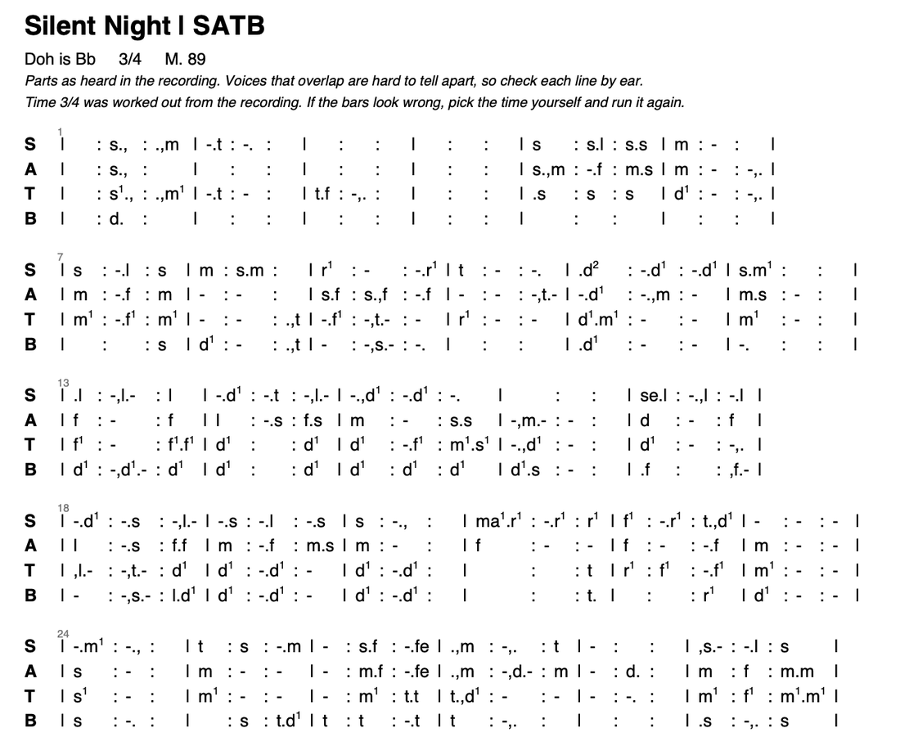

# Choir Solfa

**Website and download: [d-beloved.github.io/choir-solfa](https://d-beloved.github.io/choir-solfa/)**



Give it a song (a link or an audio file). Get the tonic solfa for soprano, alto, tenor and bass as a printable PDF, plus a text version and a MIDI file to practise with.

- **A choir singing parts:** each part is transcribed as it was sung.
- **One lead singer:** the melody becomes the soprano line, and alto, tenor and bass are written as a hymn-style arrangement under it.

Everything runs on your own computer (Mac or Windows). Nothing is uploaded anywhere except the download from the link you give it.

## Install

Go to **[d-beloved.github.io/choir-solfa](https://d-beloved.github.io/choir-solfa/)** and download the installer for your computer. Nothing else needs installing first.

You need a Mac (Apple Silicon, M1 or newer, works best; Intel Macs are slower) or a 64-bit Windows PC, with about 3 GB of free space and 8 GB of memory or more.

**Mac:** download [Install-Choir-Solfa-Mac.zip](https://github.com/d-beloved/choir-solfa/releases/download/mac-installer/Install-Choir-Solfa-Mac.zip), open it and double-click **Install Choir Solfa**. The installer isn't signed by Apple yet, so the first time your Mac says it can't check it. Click Done, then go to System Settings → Privacy & Security and click **Open Anyway**. (On macOS 14 or older: Control-click the installer, choose Open, then Open again.)

**Windows:** download [install-choir-solfa.cmd](https://d-beloved.github.io/choir-solfa/install-choir-solfa.cmd) and double-click it. If Windows says it protected your PC, click **More info**, then **Run anyway**.

A window shows the install as it goes. The first install downloads about 1 to 1.5 GB and takes a few minutes. When it finishes, **Choir Solfa** is in your Applications (Mac: Launchpad or Spotlight) or in the Start menu and on the desktop (Windows), and the page opens in your web browser.

<details>
<summary>Prefer to type? Install from Terminal or PowerShell instead</summary>

This is what the installers run. On a Mac it avoids the security warning.

**Mac:** open Terminal (press ⌘ Space, type Terminal), paste this line and press Return:

```bash
curl -LsSf https://raw.githubusercontent.com/d-beloved/choir-solfa/main/install.sh | sh
```

**Windows:** open PowerShell (Start menu, type PowerShell), paste this line and press Enter:

```powershell
powershell -ExecutionPolicy ByPass -c "irm https://raw.githubusercontent.com/d-beloved/choir-solfa/main/install.ps1 | iex"
```

</details>

- Click the icon whenever you want to use it. It runs quietly in the background and stops by itself 15 minutes after you close the page.
- The first song takes a little longer, because it downloads the voice-separation model (about 80 MB).
- Your songs stay on your computer, in the `.choir-solfa` folder in your home folder.
- **To update**, download and open the installer again (or run the same line again).
- **To remove it**, run `choir-solfa shortcut --remove`, then `uv tool uninstall choir-solfa`. Delete the `.choir-solfa` folder too if you don't want to keep your songs.

The installer uses [uv](https://docs.astral.sh/uv/) to get its own copy of Python and the app, so it doesn't touch any other Python on your computer. ffmpeg (to read audio) and Deno (which YouTube downloads need) come with the app. The Mac installer is a small app made by `scripts/make_mac_installer.py` and published on the [mac-installer release](https://github.com/d-beloved/choir-solfa/releases/tag/mac-installer) by GitHub Actions: it opens Terminal and runs `install.sh`, so it always installs the latest version.

## Development setup

```bash
uv venv --python 3.11 .venv
uv pip install -e ".[dev]"
```

On Apple Silicon, use a native arm64 Python 3.11. uv downloads one if needed. An x86 Python running under Rosetta is much slower and can't use the Core ML note model.

## Use it

Click the Choir Solfa icon, or from a terminal:

```bash
choir-solfa            # or .venv/bin/choir-solfa in a development setup
```

The page opens at http://127.0.0.1:4790. Paste a link (Spotify, YouTube and most sites yt-dlp supports) or drop an MP3, WAV, M4A or video file anywhere on the page. A 4-minute song takes about 2 to 4 minutes.

Every score you make is listed under **Your songs** on the page, newest first, so you can open, download or print it again later, even after closing the app. Reloading the page keeps you on the song you were looking at, or the one still being made. Scores are kept in `~/.choir-solfa/jobs/`, one folder per song. The × next to a song deletes its folder, after asking first.

The page checks the link as you paste it. It tells you, for example, when a Spotify link is a playlist or album rather than one song. When a score is ready, "Doesn't look right?" offers one-click fixes: switch between choir and lead singer, or change the time signature. Each fix makes the score again from the same song.

### Opening it from your phone

The page only answers on your own Mac. To reach it from elsewhere, put a tunnel such as Cloudflare Tunnel in front and tell the app the public address:

```bash
.venv/bin/choir-solfa serve --no-open --public-host solfa.example.com
```

(or set `CHOIR_SOLFA_PUBLIC_HOST`). Anyone who can open the page can make and delete songs, so put a login in front of the address, for example Cloudflare Access with email codes.

To keep it running in the background, start it from a service manager such as launchd with `--restart-when-idle` added. The app then quits itself once nobody has used it for two minutes after a song or a code change, and the service manager starts a fresh copy. That picks up code changes and gives back the 2 GB or so of memory the note models keep after a song. It never quits while a song is being made.

### Spotify links

In Spotify, open the song and use **Share → Copy song link**. Album, playlist and artist links are refused with a message.

Spotify's audio is protected, so it can't be downloaded. Instead, the tool reads the song's title, artist and length from Spotify's public song page, then searches YouTube for the same recording. It takes the closest match within 8 seconds of the Spotify length, preferring the artist's official upload and avoiding karaoke, instrumental, cover and live versions. The page and the command line both say which YouTube video was used, so you can listen and check it's the right recording. If no close match exists, it says so: upload the file or paste a YouTube link instead.

From the command line:

```bash
choir-solfa make "https://open.spotify.com/track/..." -o out/
choir-solfa make "https://www.youtube.com/watch?v=..." -o out/
choir-solfa make song.mp3 --mode solo --time 3/4 --title "Silent Night"
```

`--mode` is `auto`, `choir` or `solo`. `--time` is `auto`, `4/4`, `3/4`, `2/4` or `6/8`.

## Reading the score

You don't need to read solfa already. The page has a **How to read the score** guide (at the top, and next to the preview once a score is made). Every PDF also ends with a one-page key, so singers who only get the printout have it too.

**The notes.** `d r m f s l t d¹` (doh, ray, me, fah, soh, lah, te, doh) climb the scale. The top of the score says which note doh is, for example "Doh is Bb". Play that note on a keyboard, sing up the scale, then find your first note. The guide and the PDF key list the keyboard letter for every note in that song's key.

- `m`–`f` and `t`–`d¹` are half steps. Every other pair of neighbours is a whole step apart.
- `d¹ r¹` are above the top doh. `s₁ l₁` are below doh.
- `fe se de` are raised notes. `ta ma` are lowered notes.
- Tenor and bass are written an octave higher than they sound, as is usual. Sing them in your normal voice.
- A minor song says "minor: lah is A". It centres on lah instead of doh.

**The rhythm.** Each space between marks is one beat.

| Mark | Meaning |
|---|---|
| `\|` | Bar line |
| `:` | Beat |
| `¦` | The middle of a 4/4 or 6/8 bar (still a beat) |
| `-` | Hold the note before it |
| (empty) | Rest |
| `d.r` | Two half beats |
| `d,r.m,f` | Four quarter beats |
| `d.,r` | Three quarters, then a quarter |
| `M. 80` | 80 beats a minute |

For example, Silent Night opens `s :-.l :s | m :- :-` in 3/4: s on beat 1, s held through half of beat 2 and then l, s on beat 3, then m held for a whole bar.

**Practising.** Each part has its own row (S, A, T, B), and the beat marks line up down the page. The MIDI file opens in GarageBand, MuseScore or any MIDI player. Each part is a separate track named Soprano, Alto, Tenor and Bass, so you can mute the others or slow it down. The text version ends with a one-line key.

## How it works

1. **Get the audio:** yt-dlp for links (no playlists, at most 15 minutes and 300 MB). Spotify links are matched to the same recording on YouTube, as described above.
2. **Separate the voices:** Demucs (htdemucs) splits the voices from the instruments. If the song is mostly voices (a cappella), it listens to the whole mix instead, because separation tends to drop the lowest voices.
3. **Hear the notes:** Spotify's Basic Pitch finds every note sung, several at once. If three or more notes are often sounding together, the song is treated as a choir; otherwise as a solo.
4. **Find the beat and the bars:** librosa tracks the beat. A beat faster than 160 a minute is halved, because in echoing rooms the tracker can lock onto half beats. The beat is nudged to line up with where notes actually start. The time signature (3/4 or 4/4) is guessed from where long notes and chord changes fall.
5. **Find the key:** Krumhansl key profiles over the chroma and the notes heard. Minor keys are written in the lah mode, so doh is the relative major, as is usual in tonic solfa.
6. **Write the parts:**
   - Choir: notes are sorted into four parts by range, keeping each line smooth.
   - Solo: pyin follows the melody, then chords are chosen per beat and voiced with standard part-writing rules (no parallel fifths or octaves).
7. **Lay out the score:** standard Curwen notation (`d :r .m ,f`, `-` to hold, octave marks d¹ and d₁). Tenor and bass are written an octave above where they sound, as is customary.

## Limits

This is automatic transcription. Treat the result as a first draft and check every part by ear before teaching it.

- **Choir parts that cross or double:** they are hard to tell apart. The tool hears pitches, not who sang them.
- **Basses:** basses are often heard an octave high, or missed when the recording has little low end.
- **Held notes:** a held note sometimes shows as re-sung, especially when another part changes words at the same moment.
- **Time signature:** only 3/4 and 4/4 are guessed. Choose 6/8 or 2/4 yourself.
- **Key changes:** the song is written in a single key.
- **Spotify matches:** the YouTube copy is found by title, artist and length. It is usually the same recording, but listen to check.
- **Solo or choir:** a solo singer over a busy piano can be taken for a choir. Choose "One lead singer" if so.

## Development

```bash
.venv/bin/python -m pytest -q
```

GitHub Actions runs these on macOS and Windows, and also runs the installers on Apple Silicon, Intel Mac and Windows machines and makes a score from a test recording (`scripts/smoke.py`).

The code is under `src/choir_solfa/`. `pipeline.py` runs the steps above, `server.py` and `web/index.html` are the page, and `pdf.py` and `notation.py` lay out the score.

The website is `docs/index.html`, published by GitHub Pages from the `docs/` folder on `main`. Preview it with `.venv/bin/python -m http.server 4794 --directory docs`.

## License

MIT. See [LICENSE](LICENSE).
