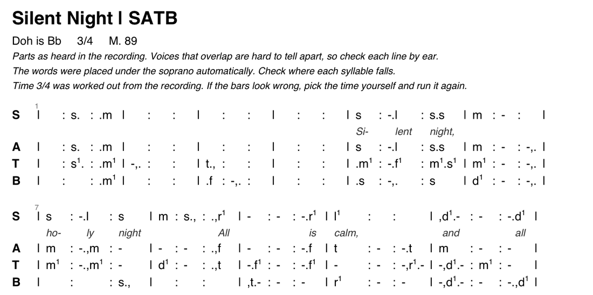

# Choir Solfa

**Use it at [solfa.morayodeji.dev](https://solfa.morayodeji.dev)**



Give it a song (a link or an audio file). Get the tonic solfa for soprano, alto, tenor and bass as a printable PDF, with the words under the soprano, plus practice tracks (the recording with each part played on top), a text version and a MIDI file.

- **A choir singing parts:** each part is transcribed as it was sung.
- **A lead singer with backing singers:** the backing singers' parts are written as soprano, alto, tenor and bass, and the lead singer's line (L) goes above them, with the words. A part the backing singers don't sing is filled in with a suggested one, and the score says when they are quiet beside the lead and so harder to hear.
- **One lead singer:** the melody becomes the soprano line, and alto, tenor and bass are written as a hymn-style arrangement under it.

## The website

Open [solfa.morayodeji.dev](https://solfa.morayodeji.dev) on a phone or computer and make an account with your email and a password. Your songs are private to your account. Each score can be downloaded for 15 days; the list of songs you've made stays.

The website runs on AWS. How it is built, and how to deploy your own copy, are in [infra/README.md](infra/README.md).

## Run it on your own computer

The same app also runs on a Mac or Windows PC, with nothing uploaded anywhere except the download from the link you give it. You need Python 3.11 (uv gets it for you), about 3 GB of free space and 8 GB of memory or more. Apple Silicon Macs are fastest.

```bash
uv venv --python 3.11 .venv
uv pip install -e ".[dev]"
```

On Apple Silicon, use a native arm64 Python 3.11. uv downloads one if needed. An x86 Python running under Rosetta is much slower and can't use the Core ML note model. ffmpeg (to read audio) and Deno (which YouTube downloads need) come with the app.

Start the page:

```bash
.venv/bin/choir-solfa
```

The page opens at http://127.0.0.1:4790. Paste a link (Spotify, YouTube and most sites yt-dlp supports) or drop an MP3, WAV, M4A or video file anywhere on the page. A 4-minute song takes about 2 to 4 minutes.

Every score you make is listed under **Your songs** on the page, newest first, so you can open, download or print it again later, even after closing the app. Reloading the page keeps you on the song you were looking at, or the one still being made. Scores are kept in `~/.choir-solfa/jobs/`, one folder per song. The × next to a song deletes its folder, after asking first.

The page checks the link as you paste it. It tells you, for example, when a Spotify link is a playlist or album rather than one song. When a score is ready, "Doesn't look right?" offers one-click fixes: switch between a choir, a lead singer with backing singers and one lead singer, or change the time signature. Each fix makes the score again from the same song.

### Spotify links

In Spotify, open the song and use **Share → Copy song link**. Album, playlist and artist links are refused with a message.

Spotify's audio is protected, so it can't be downloaded. Instead, the tool reads the song's title, artist and length from Spotify's public song page, then searches YouTube for the same recording. It takes the closest match within 8 seconds of the Spotify length, preferring the artist's official upload and avoiding karaoke, instrumental, cover and live versions. The page and the command line both say which YouTube video was used, so you can listen and check it's the right recording. If no close match exists, it says so: upload the file or paste a YouTube link instead.

From the command line:

```bash
.venv/bin/choir-solfa make "https://open.spotify.com/track/..." -o out/
.venv/bin/choir-solfa make "https://www.youtube.com/watch?v=..." -o out/
.venv/bin/choir-solfa make song.mp3 --mode solo --time 3/4 --title "Silent Night" --lyrics words.txt
```

`--mode` is `auto`, `choir`, `backing` (a lead singer with backing singers) or `solo`. `--time` is `auto`, `4/4`, `3/4`, `2/4` or `6/8`.

## Reading the score

You don't need to read solfa already. The page has a **How to read the score** guide (at the top, and next to the preview once a score is made). Every PDF also ends with a one-page key, so singers who only get the printout have it too.

**The notes.** `d r m f s l t d¹` (doh, ray, me, fah, soh, lah, te, doh) climb the scale. The top of the score says which note doh is, for example "Doh is Bb". Play that note on a keyboard, sing up the scale, then find your first note. The guide and the PDF key list the keyboard letter for every note in that song's key.

- `m`–`f` and `t`–`d¹` are half steps. Every other pair of neighbours is a whole step apart.
- `d¹ r¹` are above the top doh. `s₁ l₁` are below doh.
- `fe se de` are raised notes. `ta ma` are lowered notes.
- Tenor and bass are written an octave higher than they sound, as is usual. Sing them in your normal voice.
- A minor song says "minor: lah is A". It centres on lah instead of doh.

**The rhythm.** Each space between marks is one beat.

| Mark | Meaning |
|---|---|
| `\|` | Bar line |
| `:` | Beat |
| `¦` | The middle of a 4/4 or 6/8 bar (still a beat) |
| `-` | Hold the note before it |
| (empty) | Rest |
| `d.r` | Two half beats |
| `d,r.m,f` | Four quarter beats |
| `d.,r` | Three quarters, then a quarter |
| `M. 80` | 80 beats a minute |

For example, Silent Night opens `s :-.l :s | m :- :-` in 3/4: s on beat 1, s held through half of beat 2 and then l, s on beat 3, then m held for a whole bar.

**The words.** For a link, the words are looked up and written under the soprano, each syllable under the note it's sung on. `Si- lent` means the word goes on to the next note. For an uploaded file, or when the words aren't found, paste them under **Words** on the page, each line of the song on its own line, with any repeats, as it's sung. From the command line, use `--lyrics words.txt`.

**Practising.** Each part has its own row (S, A, T, B), and the beat marks line up down the page. Each part (and the lead line, when there is one) also gets a practice track: the recording with that part played on top in a soft tone, in time with the song, plus one track with all four parts. Where a written note is wrong you hear it clash with the singers, so the tracks are also the quickest way to check a score by ear. The MIDI file opens in GarageBand, MuseScore or any MIDI player. Each part is a separate track named Soprano, Alto, Tenor and Bass, so you can mute the others or slow it down. The text version ends with a one-line key.

## How it works

1. **Get the audio:** yt-dlp for links (no playlists, at most 15 minutes and 300 MB). Spotify links are matched to the same recording on YouTube, as described above.
2. **Separate the voices:** Demucs (htdemucs) splits the voices from the instruments. If the song is mostly voices (a cappella), it listens to the whole mix instead, because separation tends to drop the lowest voices.
3. **Hear the notes:** Spotify's Basic Pitch finds every note sung, several at once. If three or more notes are often sounding together, the song is treated as a choir. Otherwise a second model ([UVR](https://github.com/Anjok07/ultimatevocalremovergui)'s MDX-Net karaoke model, downloaded once on first use, about 50 MB) splits the lead singer from the backing singers. If the backing singers sing for a good share of the song, their parts are written along with the lead singer's line; if not, the song is treated as a solo.
4. **Find the beat and the bars:** librosa tracks the beat. A beat faster than 160 a minute is halved, because in echoing rooms the tracker can lock onto half beats. The beat is nudged to line up with where notes actually start. The time signature (3/4 or 4/4) is guessed from where long notes and chord changes fall.
5. **Find the key:** Krumhansl key profiles over the chroma and the notes heard. Minor keys are written in the lah mode, so doh is the relative major, as is usual in tonic solfa.
6. **Write the parts:**
   - Choir: notes are sorted into four parts by range, keeping each line smooth. With backing singers, their lines are also put in the key and on the beat, and a part they leave out is written by the solo arranger below.
   - Solo: pyin follows the melody, then chords are chosen per beat and voiced with standard part-writing rules (no parallel fifths or octaves).
7. **Place the words:** for links, the words come from [LRCLIB](https://lrclib.net). Each syllable is matched to a soprano note, allowing for held notes, rests between lines and lines the singers leave out.
8. **Lay out the score:** standard Curwen notation (`d :r .m ,f`, `-` to hold, octave marks d¹ and d₁). Tenor and bass are written an octave above where they sound, as is customary.

## Limits

This is automatic transcription. Treat the result as a first draft and check every part by ear before teaching it.

- **Choir parts that cross or double:** they are hard to tell apart. The tool hears pitches, not who sang them.
- **Basses:** basses are often heard an octave high, or missed when the recording has little low end.
- **Held notes:** a held note sometimes shows as re-sung, especially when another part changes words at the same moment.
- **Time signature:** only 3/4 and 4/4 are guessed. Choose 6/8 or 2/4 yourself.
- **Key changes:** the song is written in a single key.
- **Words:** they are placed by matching syllables to the notes heard, so check where each one falls. Later verses can drift where the singing is unclear.
- **Spotify matches:** the YouTube copy is found by title, artist and length. It is usually the same recording, but listen to check.
- **Solo or choir:** a solo singer over a busy piano can be taken for a choir. Choose "One lead singer" if so.

## Development

```bash
.venv/bin/python -m pytest -q
```

GitHub Actions runs these on macOS and Windows.

The code is under `src/choir_solfa/`. `pipeline.py` runs the steps above, `server.py` and `web/index.html` are the page, and `pdf.py` and `notation.py` lay out the score. The website's API is `cloud/api/handler.py`, the song maker it starts is `cloud_worker.py`, and `infra/` creates it all on AWS.

## License

MIT. See [LICENSE](LICENSE).
